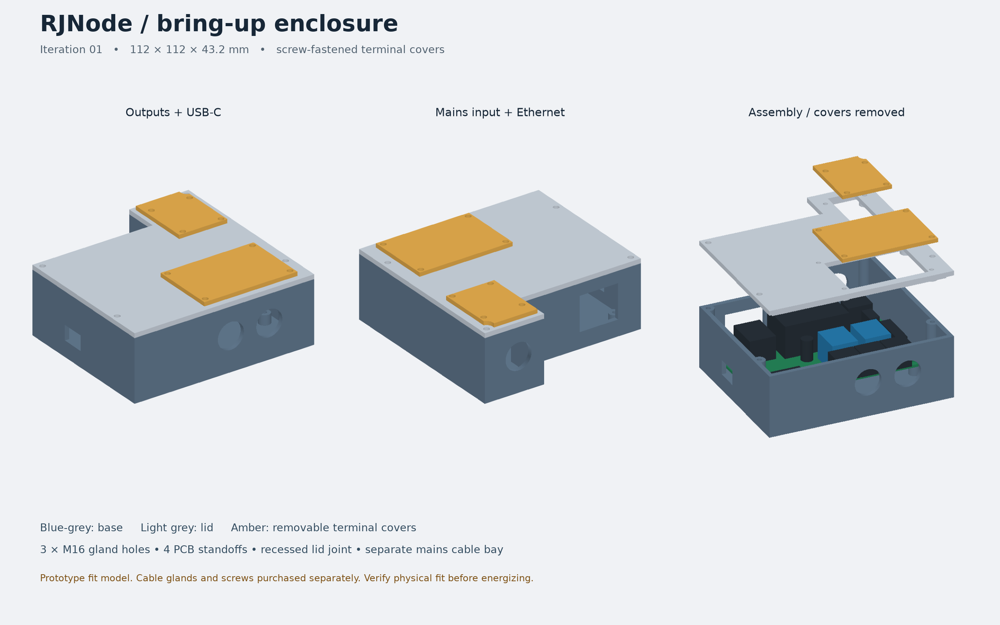

# RJNode enclosure — iteration 1

> **Superseded: use [v2](../v2/README.md). Do not print the original v1 exports: their connector layout is mirrored due to an incorrect KiCad-to-CAD Y-axis conversion. V2 fixes this.**

A bench bring-up enclosure sized from `../../RJNode.kicad_pcb`: 100 × 60 mm PCB, R4 corners, four Ø3.2 mm holes on a 92 × 52 mm pattern. Firmware and PCB files are untouched.



## Files

- `base.stl`, `lid.stl`, `outputs_cover.stl`, `input_cover.stl`: print one of each. They are already individually oriented and placed on Z=0. Import as **separate parts**, not as an assembly.
- `fit_coupon.stl`: optional pilot-hole sizing strip; holes are Ø2.5 / 2.6 / 2.7 / 2.8 mm from left to right.
- `RJNode_enclosure_v1.FCStd`: assembled CAD with PCB and conservative component envelopes. Reference bodies are not printable parts. Hide them as needed.
- `enclosure_assembly.step`: enclosure assembly only; individual STEP files are also included. STEP retains the assembled coordinates, unlike the print-oriented STLs.
- `build.py`: editable dimensions and CAD generator; `render.py`: preview generator.
- `validation.json`: CAD validity, print dimensions, interference results, and source PCB hash.

## Design

Overall body footprint is 112 × 112 mm, with a stepped rear edge. Height is 40.8 mm at the main lid and 43.2 mm over the terminal covers, excluding screw heads and purchased glands. Walls and floor are 2.8 mm. The PCB underside is 8.8 mm above the outside bottom: 6 mm above the inside floor. Trim protruding component leads so they cannot approach or touch the floor.

The lid has a 2.5 mm descending locating lip, with 0.35 mm clearance per side. Four screws retain it independently of the PCB screws. Two smaller screw-fastened covers give vertical screwdriver and wiring access while the main lid remains installed. The rear cover has a corner relief for the adjacent main-lid screw.

| Connection | Access |
| --- | --- |
| J501 OUT1, J502 OUT2, J503 output neutrals | One removable top cover, 48 × 33 mm opening; two output glands in the front wall |
| J101 mains L/N | Separate rear top cover, 16 × 31 mm opening, aligned with both screw axes; one rear gland |
| J401 Ethernet | 24 × 21 mm rear opening, wall about 5 mm beyond the jack face; extra latch/boot space |
| J6 USB-C | 14 × 9 mm side opening; receptacle face recessed about 2.6 mm from inner wall |
| BOOT, UART test pads | Internal; remove the main lid with power disconnected |

The rear step and a solid partition confine the mains input cable bay away from the Ethernet opening. No ribs enter the PCB isolation slots. There are no ventilation openings above the mains area. This enclosure does not add a certified mains/SELV insulation barrier or remedy PCB/component insulation limitations.

Two output cables are assumed, each carrying its channel's switched conductor(s) and neutral. The gland selection must match the actual cable diameter and conductor count. This design does not provide a PE terminal or a reserved PE splice compartment; if PE is required, use a suitable separate enclosed splice and never connect PE to this PCB.

## Purchased hardware

| Item | Quantity | Notes |
| --- | --- | --- |
| Nylon M3 × 6 pan-head screws | 4 | PCB mounting, no metal washers; 4.4 mm nominal engagement after 1.6 mm PCB |
| M3 × 8 pan-head plastic-compatible screws | 4 | Main lid; 5.2 mm nominal engagement |
| M3 × 6 pan-head plastic-compatible screws | 8 | Terminal covers; 3.6 mm nominal engagement |
| Insulating M16 cable glands with locknuts | 3 | Ø16.2 mm printed holes; select body/nut OD ≤23 mm and inner projection ≤6 mm |
| Suitable blanking plugs | As needed | Close unused gland holes before energizing |

The printed pilots are Ø2.7 mm. Print the coupon and check your actual screw and material combination first. Use pan heads approximately ≤6 mm diameter; do not countersink. Screw lengths are measured under the head. There are no heat-set inserts. Avoid over-tightening printed threads. If the coupon requires a different pilot diameter, change `PILOT_D` and regenerate.

## Printing

Use a 0.4 mm nozzle, about 0.2 mm layers, at least five perimeters, and at least six top/bottom layers. About 30–40% infill is a starting point; inspect the sliced floor, bosses and walls for continuity. Use the orientations supplied in the STLs. The lid prints exterior-face down, with its locating lip and blind bosses pointing up; covers print flat. Add local supports beneath the upper arches/roofs of the base's connector and gland openings as required by your printer. Remove all support debris before assembly. Check the USB and Ethernet openings with the actual cables, including boot and latch clearance.

For **unpowered fit checks**, use a material your printer handles accurately. For mains bring-up, use the project's enclosure material requirement: flame-retardant PC or PC/ABS with documented suitability for the intended process and wall thickness. A filament's UL94 claim alone does not establish a rating for this printed part. Ordinary PLA/PETG fit prints are not the intended energized enclosure.

## Assembly and first fit

1. With mains and USB disconnected, print the coupon, then base. Check the four mounting holes, underside lead clearance, and that the PCB sits flat without force. Check actual PSU, relay, terminal and capacitor heights. Do not drill the PCB to compensate for a fit error.
2. Install and tighten the three glands or suitable blanks. Check their locknuts clear the floor, lid and screw columns. Ream only the printed mounting holes if necessary for the chosen glands.
3. Fasten the PCB with four nylon M3 × 6 screws. Verify screw tips stay within the standoffs and the board cannot rock or slide.
4. Feed cables through glands and wire terminals with the main lid removed. Front outputs are J501, J502 and J503; rear input is J101. Follow the fabricated PCB markings and confirm electrically; do not infer L/N or NO/NC from cable position. On the design PCB, left-to-right in KiCad's top view: J501 NC/NO, J502 NC/NO, J503 N/N; J101 L/N.
5. Keep every stripped conductor inside its terminal and keep mains wiring in the cable bays. Clamp the **outer cable jacket** in each gland and perform a gentle pull check; terminal screws must not provide cable strain relief. Check wire bends do not load the terminal blocks or trap wires under the lid.
6. Fit the main lid and all covers. Verify connector insertion, Ethernet latch release, and that every screw tightens without cracking or bottoming out. The cover openings permit subsequent terminal adjustment only with power disconnected; initial gland installation and cable dressing are easier with the main lid off.
7. Before 230 V bring-up, inspect the assembled unit and wiring for accessible live parts and printing defects. Fit all covers and gland blanks. Perform the project's electrical checks, then monitor enclosure/component temperature during the initial load test. The sealed geometry's thermal performance is unverified; do not assume the PCB's proposed load rating is validated by this enclosure.

Access ports and a desktop CAD fit check do **not** establish IP2X/IPXXB, Class II, dielectric strength, flame containment, or production suitability. This is a first mechanical prototype. Isolate power before opening or adjusting terminals. HSE's [electrical testing guidance](https://www.hse.gov.uk/pubns/indg354.pdf) explains the need to prevent contact with exposed live parts during testing.

## Geometry evidence and limits

`build.py` checks that each printable part is one valid CAD solid, that the four enclosure pieces have no overlapping volume, and that no enclosure part intersects the PCB or modeled component envelopes. The check includes the case joint, terminal cover bosses and the rear wiring divider. The models are **envelopes**, not a complete assembly simulation: solder, cable boots, wires, glands, screw heads, every SMD component and print tolerances are not fully modeled.

The fitted terminals are DB128V-7.62-2P-GN-S on 7.62 mm pitch, not the older 5 mm parts used in earlier revisions. XY positions and mounting geometry come directly from the PCB. Height allowances above PCB are terminals 14.6 mm, relays 16.5 mm, PSU 20 mm, Ethernet 14.2 mm, bulk capacitor 13 mm and MOV 14 mm. The nominal [Hi-Link PSU dimensions](https://www.hilinkpower.com/ProductCenter/Aside.html?Id=7353733741692215296&Name=5W%E7%B3%BB%E5%88%97) are 38 × 23 × 18 mm; the CAD allows 39 × 23.5 × 20 mm. The local supplier 3D files have inconsistent origins/bounds, so they were not treated as authoritative assembled bodies. Measure the populated board before energizing.

Rebuild on this workstation:

```sh
/usr/bin/python3 3d/v1/build.py
/usr/bin/python3 3d/v1/render.py
```

The builder requires FreeCAD Python libraries at `/usr/lib/freecad/lib`; adjust that path for another installation. Rendering additionally needs NumPy and Matplotlib. All generated output stays in `3d/v1/`.
