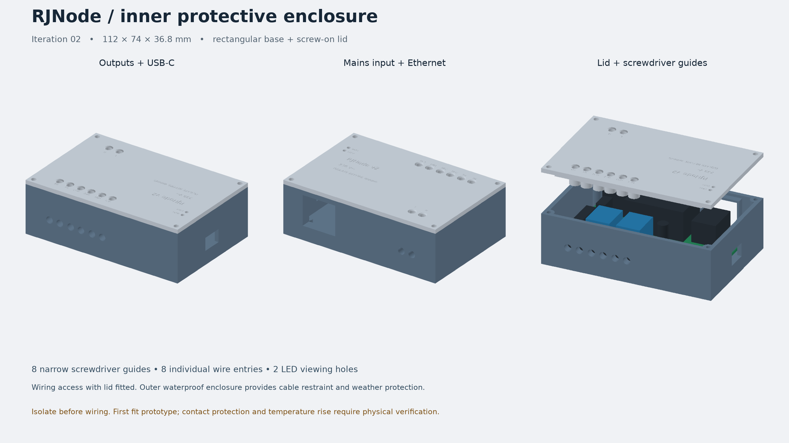

# RJNode inner enclosure — v2

A simple rectangular base and screw-on lid for installation **inside the client's waterproof enclosure**. This inner case guards the PCB and restricts casual finger access; the outer enclosure supplies weather protection, mounting and cable restraint. No glands or separate terminal covers are needed on this inner case.



## Files

Print one `base.stl` and one `lid.stl`. Each is already oriented and placed on Z=0; import them as separate printable objects. `fit_coupon.stl` is an optional M3 pilot-hole coupon, with holes Ø2.5 / 2.6 / 2.7 / 2.8 mm from left to right.

`RJNode_enclosure_v2.FCStd` includes the assembled case, PCB and component reference envelopes; hide the reference objects as needed. `enclosure_assembly.step` contains only the two enclosure parts, in assembled coordinates. The exported assembly converts KiCad’s downward Y axis to CAD’s upward Y axis so the connector layout has the correct handedness. Individual STEP files and the editable generator `build.py` are also supplied. STEP assembly positions differ from the print-oriented STLs.

## Dimensions and access

| Feature | v2 |
| --- | --- |
| External dimensions, excluding screw heads | 112 × 74 × 36.8 mm |
| Walls / floor / lid | 2.8 mm |
| Clearance from inside floor to PCB underside | 6 mm |
| PCB mounting | Four bosses at the existing Ø3.2 mm PCB holes, 92 × 52 mm pattern |
| Lid fastening | Four M3 screws, independent of PCB fastening |
| Screwdriver access | Eight Ø4.4 mm guide bores, with small top lead-ins |
| Insulated wire entry | Eight Ø4.8 mm holes, aligned with individual terminal mouths |
| LED viewing | Two Ø2.4 mm holes above D601 and LED3, with underside relief |
| Ethernet | Rear opening with a short internal shroud around the socket approach |
| USB-C | Left-side opening, retained for programming |
| BOOT | Internal; no opening |

The screw guides extend down from the lid to Z=25.4 mm, about 0.9 mm above the nominal 14.1 mm-high terminal bodies. Their outside diameter is 7.2 mm. They confine the screwdriver path and screen adjacent live screw heads. The body has short wire-entry guides ending about 0.65 mm ahead of the nominal terminal front faces. There are no ribs inside the PCB isolation slots.

The main lid has a descending lip with 0.35 mm clearance per side. The Ethernet shroud meets the rear wall and surrounds the plug approach, reducing access around the jack. The straight rectangular perimeter is retained on all sides.

## Wiring with the lid fitted

Individual **insulated conductors**, rather than whole cable jackets, enter this inner case. Anchor each cable's outer jacket in the outer enclosure, then route the insulated conductors to the appropriate small holes. This design assumes conductor insulation diameter **at most 4.2 mm**, leaving 0.3 mm nominal clearance per side in a 4.8 mm hole. Conductor cross-section alone does not specify insulation diameter. Check your actual wires and ferrules before printing a batch.

Use a slim insulated screwdriver with overall shaft/insulation diameter **at most 4.0 mm** and a tip suitable for the fitted terminal. The long bore is 4.4 mm; a larger conventional insulated shaft may not fit. Check that the tool reaches and engages every screw before energizing. Do not use an uninsulated tool to compensate for a fit problem.

With supply disconnected and proved dead, loosen the terminal through its top guide, insert the prepared conductor through the corresponding side hole, then tighten through the guide. Confirm secure seating and perform an unpowered pull check. Follow the actual terminal's strip length and torque specifications. All stripped copper must remain inside the terminal housing. The lid can remain screwed down throughout this operation.

| Lid mark | PCB terminal | Signal |
| --- | --- | --- |
| NC1 / NO1 | J501 | Channel 1 normally closed / normally open |
| NC2 / NO2 | J502 | Channel 2 normally closed / normally open |
| N1 / N2 | J503 | Output neutral / output neutral |
| L / N | J101 | Mains input line / neutral |

Labels follow the current PCB net assignments; confirm against the fabricated board and actual wiring. Small LED openings are marked D601 and LED3. They provide direct, mainly overhead viewing of the SMD LEDs; brightness and viewing angle need checking on the populated board. The two LEDs in the Ethernet jack remain visible through the Ethernet opening.

PE is not connected to the PCB. If required by the installation, provide its appropriate enclosed splice in the outer enclosure. This case contains no PE splice holder.

## Printing and assembly

Suggested starting settings: 0.4 mm nozzle, 0.2 mm layers, five or more walls, six or more top/bottom layers, and about 30–40% infill. Inspect the sliced bosses and small guides for continuity. Print the base upright and the lid exterior-face down, as already arranged in the STLs. In that orientation the screwdriver tubes point upward and need no internal supports. The shallow engraved labels are on the bed-facing lid surface; first-layer quality affects readability.

Use local support under the base's horizontal port roofs, wire-guide bores and Ethernet shroud as needed by your printer. Remove all support, especially from the conductor paths. Do not leave rough edges that could abrade insulation. Print the base first for an unpowered PCB and wire-entry fit check.

Hardware:

- Four **nylon M3 × 6** pan-head screws for PCB mounting; no metal washers. Nominal engagement is 4.4 mm below a 1.6 mm PCB.
- Four **M3 × 8** pan-head screws compatible with plastic for the lid. Nominal engagement is 5.2 mm. Head diameter should be approximately 6 mm or less.
- No heat-set inserts, glands or separate access covers.

The printed pilot diameter is 2.7 mm. Use the optional coupon to check the actual screw/material combination and change `PILOT_D` if needed. Avoid over-tightening. Check the populated PCB sits flat, that lead protrusions clear the floor, and that neither screw tips nor guide tubes touch components. Mount the PCB and fit the lid once before installation; subsequent terminal wiring uses the provided openings.

Keep the project's flame-retardant PC or PC/ABS material requirement for energized use. A filament's fire-rating claim does not establish the rating of this printed part. Ordinary PLA/PETG may be used for an **unpowered fit mock-up**.

## Verification and limits

The generator verifies:

- Both case parts and the optional coupon are single valid CAD solids and closed STL meshes.
- The base and lid do not overlap, and neither intersects the PCB or modeled component envelopes.
- All eight nominal Ø4.0 mm screwdriver paths and eight Ø4.2 mm wire paths clear the enclosure geometry.
- Both LED viewing bores are open.
- The terminal-pad coordinates, both LED positions and all four mounting holes match the current PCB file.

Terminal screw axes are offset by 0.551 mm from the pad row toward the wire-entry face. This offset and the nominal wire-mouth height come from the local DB128V-7.62 terminal model, correcting its inconsistent X origin against the footprint. They need a **physical fit check on the actual assembled terminal blocks**; the checks cannot validate the supplier model against the real parts.

The reference envelopes allow 20 mm above the PCB for the PSU, 16.5 mm for the relays and 14.6 mm for the terminals. The PSU has 3.6 mm nominal clearance to the underside of the lid. Other small components, solder, wires, plugs, screw heads and the outer enclosure are not exhaustively modeled. This is a first mechanical fit of v2; there has been no physical contact-probe, dielectric, fire or thermal testing. No IP, Class II or electrocution-prevention certification is claimed. Test temperature rise with the device inside its actual outer enclosure.

**The access holes do not make live wiring safe.** Isolate and prove dead before inserting wires or tools, as described in [HSE's electrical safety guidance](https://www.hse.gov.uk/electricity/faq.htm). Install and inspect the inner guard before energizing; check that all exposed conductor remains within its terminal and that cables cannot pull on the PCB terminals.

## Rebuild

From the repository root:

```sh
/usr/bin/python3 3d/v2/build.py
/usr/bin/python3 3d/v2/render.py
```

The generator uses system FreeCAD libraries at `/usr/lib/freecad/lib` and KiCad's `pcbnew`. Its font path is configurable via `FONT`; the supplied exports include the engraved labels. Rendering also uses NumPy and Matplotlib. All output goes to `3d/v2/`. The v1 design, PCB and firmware are unchanged.

## KiCad 3D preview

The complete v2 case is attached to **H5**, using `${KIPRJMOD}/3d/v2/kicad_case_H5.step`. Its local origin and orientation match H5; model offset and rotation are zero and scale is 1. The PCB is unchanged except for this footprint's model entry. Reopen/reload the board and refresh its 3D viewer to see it. To temporarily hide the case, disable its model in H5 → Properties → 3D Models.

After regenerating the enclosure assembly, regenerate the footprint-local model:

```sh
/usr/bin/python3 3d/v2/prepare_kicad_model.py
```

The model generator reads H5's position and rotation from the PCB. KiCad's native STEP export verified the installed enclosure bounds within 0.01 mm of the source assembly; `kicad-preview.png` was rendered by KiCad itself.
